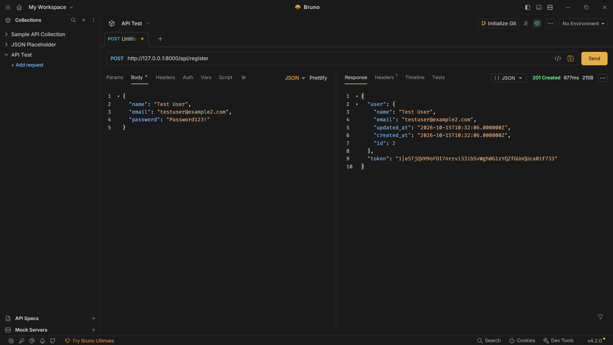
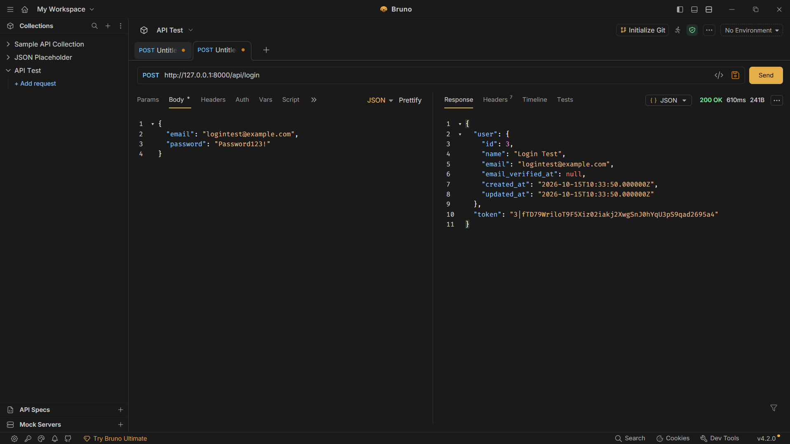
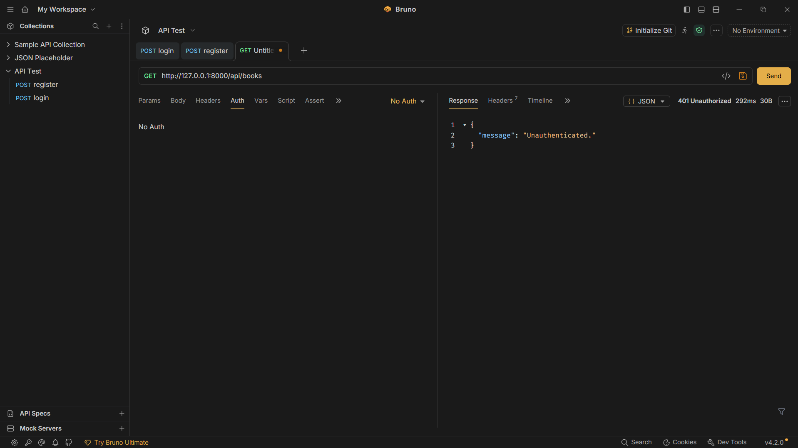
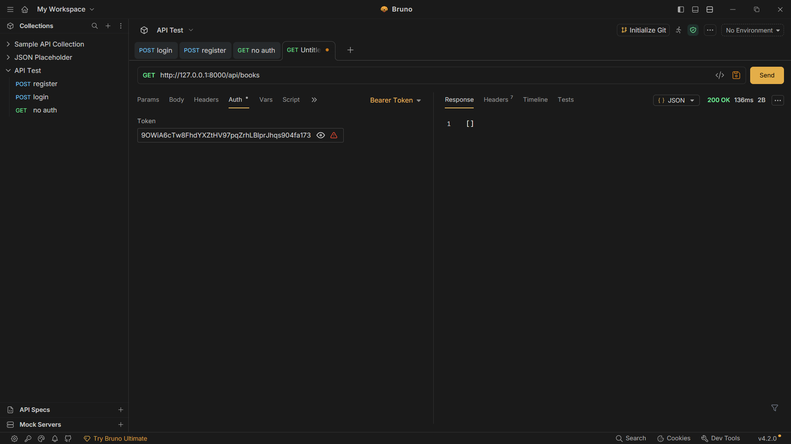
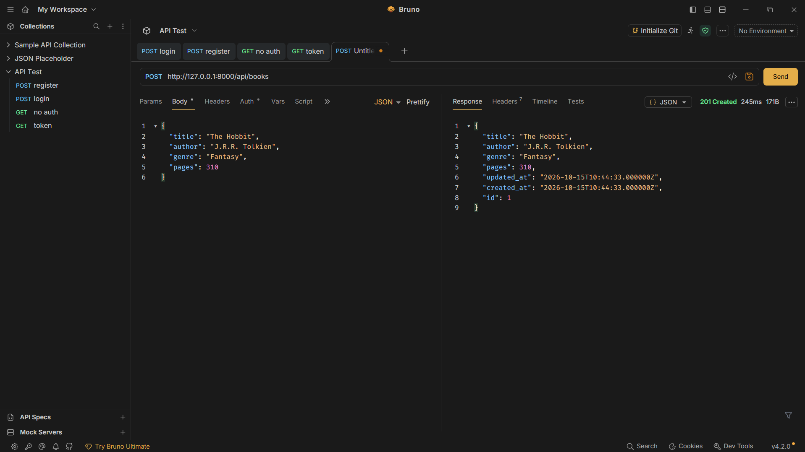
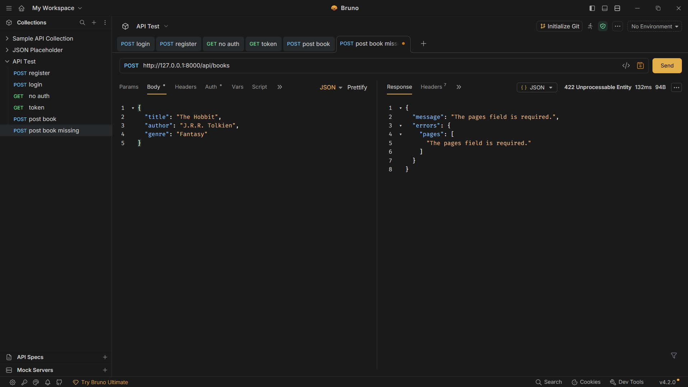
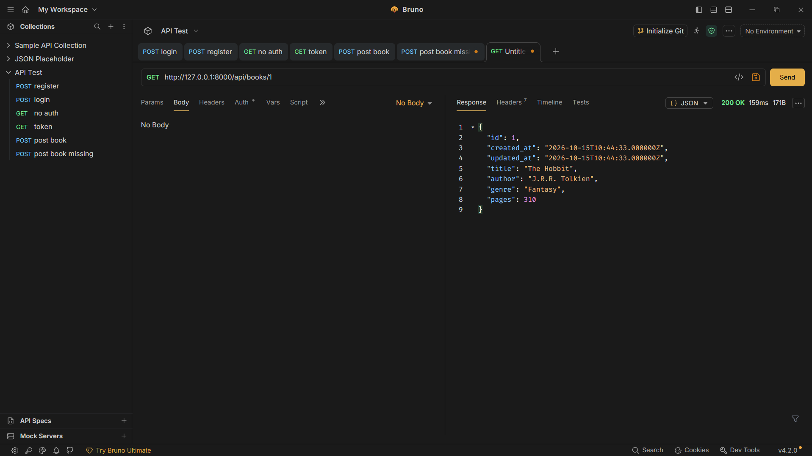
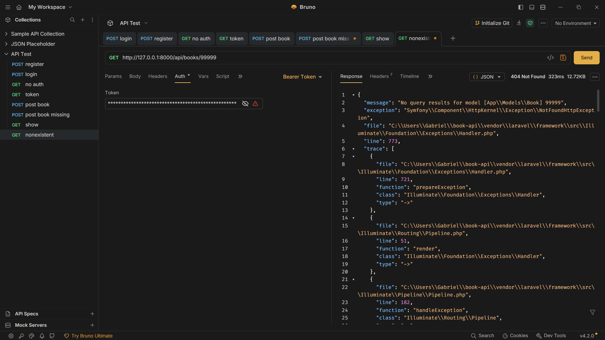
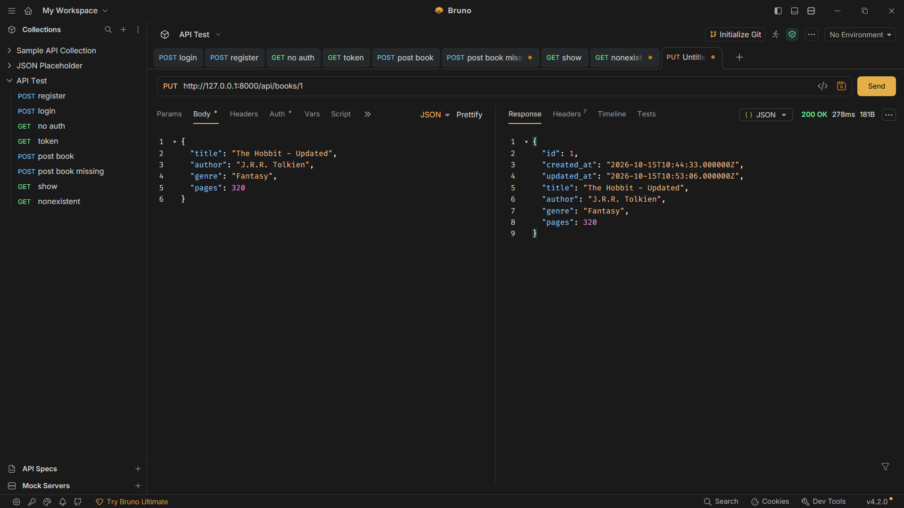
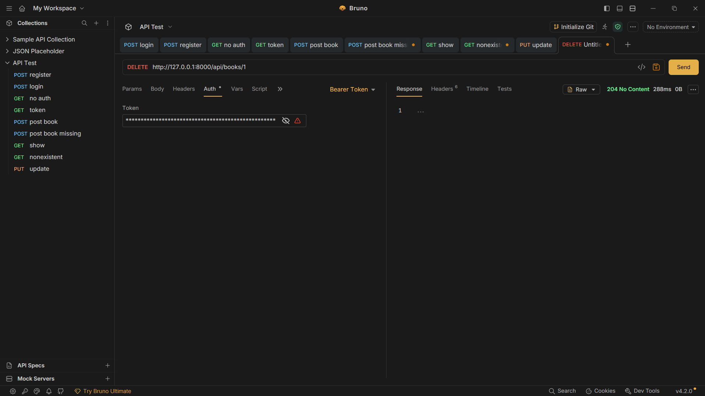

### Book API

Course: CIT 3102 – Systems Integration and Architecture
Module: 5 – Build an API
De Leon, Gabriel Martin
Vida, Stanlee Edgar
Section: IT2E
Resource Chosen: Book

---

## Project Setup

These instructions explain how to run the Book API from a fresh clone of the repository.

### Prerequisites

* PHP and Composer
* Laravel Herd or another local PHP environment
* Git
* Bruno for API testing

### Installation

**Step 1: Clone the repository**

```bash
git clone <repository-url>
cd book-api
```

Replace `<repository-url>` with the actual URL of the Git repository.

**Step 2: Install dependencies**

```bash
composer install
```

**Step 3: Configure the environment**

Create a local environment file:

```bash
cp .env.example .env
```

On Windows PowerShell, you can use:

```powershell
Copy-Item .env.example .env
```

Generate the application key:

```bash
php artisan key:generate
```

**Step 4: Configure SQLite**

Ensure that the `.env` file uses SQLite:

```env
DB_CONNECTION=sqlite
```

Create the SQLite database file if it does not already exist:

```powershell
New-Item -ItemType File -Path database/database.sqlite
```

If the file already exists, do not recreate it.

**Step 5: Run the database migrations**

```bash
php artisan migrate
```

This creates the database tables required by the application.

**Step 6: Start the Laravel development server**

```bash
php artisan serve
```

The API will be available at:

`http://127.0.0.1:8000`

**Step 7: Test using Bruno**

Use Bruno to send HTTP requests to the API. Register a user, log in, and copy the returned token. Use the token as a Bearer Token for protected endpoints.

> Note: The repository must include the application code, migrations, and `routes/api.php`. Sanctum must be configured for API token authentication. Do not commit your personal `.env` file or real access tokens.

---

## Table

The API provides nine routes for book management and authentication.

| HTTP Verb | Path                | Description                                               | Token Required |
| --------- | ------------------- | --------------------------------------------------------- | -------------- |
| POST      | `/api/register`     | Register a new user and issue an API token                | No             |
| POST      | `/api/login`        | Authenticate a user and issue an API token                | No             |
| POST      | `/api/logout`       | Revoke the current access token                           | Yes            |
| GET       | `/api/me`           | Return the authenticated user's information               | Yes            |
| GET       | `/api/books`        | Retrieve all books; supports `genre` and `author` filters | Yes            |
| POST      | `/api/books`        | Create a book                                             | Yes            |
| GET       | `/api/books/{book}` | Retrieve a specific book by ID                            | Yes            |
| PUT       | `/api/books/{book}` | Update a book by ID                                       | Yes            |
| DELETE    | `/api/books/{book}` | Delete a book by ID                                       | Yes            |

### Book Fields

Each book contains the following fields:

| Field    | Data Type |
| -------- | --------- |
| `title`  | String    |
| `author` | String    |
| `genre`  | String    |
| `pages`  | Integer   |

### Filtering Examples

Retrieve all books:

```http
GET /api/books
```

Filter by genre:

```http
GET /api/books?genre=fiction
```

Filter by genre and author:

```http
GET /api/books?genre=fiction&author=Rizal
```

The API uses a whitelist of permitted filter fields: `genre` and `author`.

---

## Ten Screenshots of Step 6

### Test 1 — Register a User

**Request:** `POST /api/register`
**Expected Status:** `201 Created`

Screenshot:



### Test 2 — Log In

**Request:** `POST /api/login`
**Expected Status:** `200 OK`

Screenshot:



### Test 3 — Access Books Without a Token

**Request:** `GET /api/books`
**Authentication:** No Auth
**Expected Status:** `401 Unauthorized`

Screenshot:



### Test 4 — Access Books With a Token

**Request:** `GET /api/books`
**Authentication:** Bearer Token
**Expected Status:** `200 OK`

Screenshot:



### Test 5 — Create a Book

**Request:** `POST /api/books`
**Authentication:** Bearer Token
**Expected Status:** `201 Created`

Screenshot:



### Test 6 — Create a Book With a Required Field Missing

**Request:** `POST /api/books`
**Authentication:** Bearer Token
**Expected Status:** `422 Unprocessable Entity`

Screenshot:



### Test 7 — Retrieve a Specific Book

**Request:** `GET /api/books/1`
**Authentication:** Bearer Token
**Expected Status:** `200 OK`

Screenshot:



### Test 8 — Retrieve a Nonexistent Book

**Request:** `GET /api/books/99999`
**Authentication:** Bearer Token
**Expected Status:** `404 Not Found`

Screenshot:



### Test 9 — Update a Book

**Request:** `PUT /api/books/1`
**Authentication:** Bearer Token
**Expected Status:** `200 OK`

Screenshot:



### Test 10 — Delete a Book

**Request:** `DELETE /api/books/1`
**Authentication:** Bearer Token
**Expected Status:** `204 No Content`

Screenshot:



---

## 4. Why Does DELETE Return 204 Instead of 200?

HTTP status codes tell the client what happened to its request. When a DELETE request returns `204 No Content`, it means the server successfully deleted the resource and has no additional response body to send. A `200 OK` response is also a success, but it is commonly used when the server returns information in the response body, such as a confirmation message.`204` clearly communicates that the deletion succeeded and there is no content to return.
